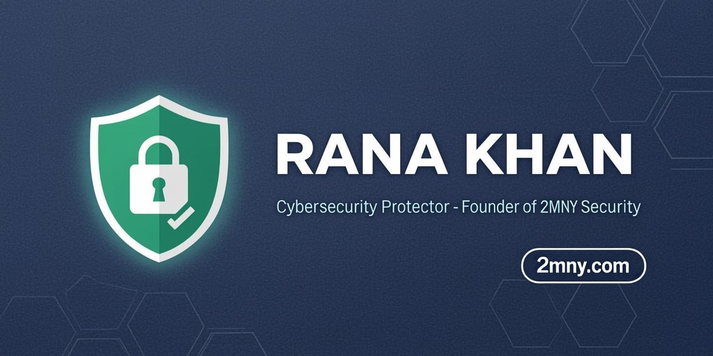
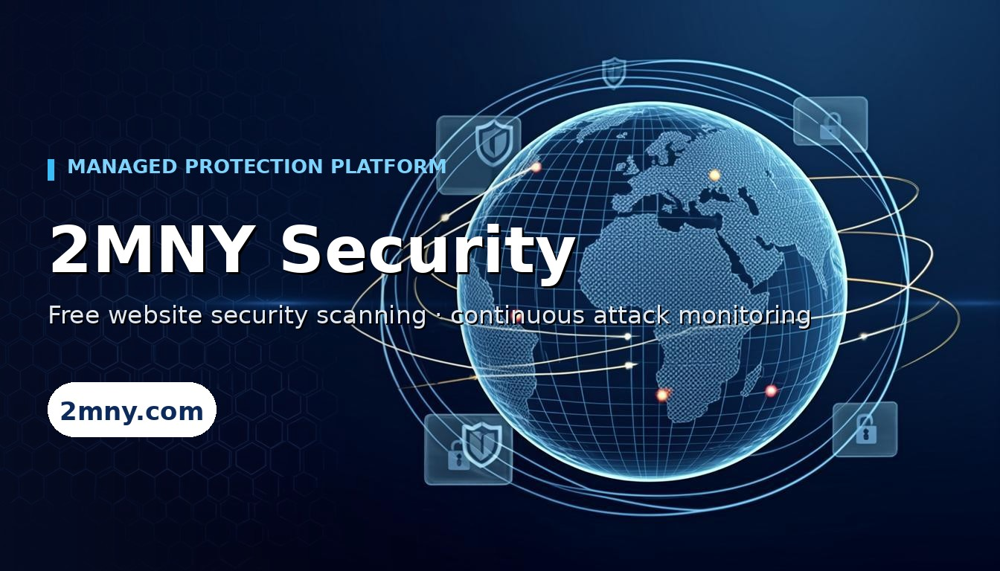

<div align="center">



# 👋 Rana Khan

### 🛡️ Cybersecurity Protector · Security Researcher · Founder of [2MNY Security](https://2mny.com)

**I build cybersecurity protection tools that run on *your* own hardware** — deterministic engines,
evidence-backed findings, CVSS-scored reports, zero AI lock-in, zero token billing.

🌍 *My mission: help keep the cyber world safe from attackers. Every tool I build exists to protect
people, teams and communities — and I'm proud to contribute to a safer digital Bangladesh and a
safer internet for everyone.*

&nbsp;

[](https://2mny.com)
[](https://2mny.com/free-security-scan)
[](https://2mny.com/blog)
[](https://github.com/RanaKhan77?tab=repositories)

&nbsp;

</div>

---

## 🎯 What I Protect

Building protection tools that find weaknesses **before attackers do** — so website owners can fix
them first. Everything is defensive: detection, evidence, and a clear fix plan. Nothing I build is
for attacking anyone.

### 🚀 [Website Vulnerability Scanner — Community Edition](https://github.com/RanaKhan77/Website-Vulnerability-Scanner)
**The largest fully-deterministic, self-hostable website protection suite ever open-sourced.**

| | |
|---|---|
| 🧩 **200 scanner modules** | Finds XSS · SQLi · SSRF · SSTI · command injection · subdomain takeover · OWASP Top 10 risks |
| 🤖 **AI-stack safety** | MCP server auditing · LLM Top-10 exposure · agent panels · leaked AI keys |
| 📄 **Evidence-backed reports** | CVSS-scored findings, HTML/PDF, technical + customer variants |
| 🏠 **100% self-hosted** | One Docker command — no API keys, no token billing, no vendor lock |
| ⚔️ **Battle-tested** | False-positive guards, soft-404 baselining, WAF detection, ownership gating |

```bash
git clone https://github.com/RanaKhan77/website-vulnerability-scanner.git   # your own 200-module protection lab
```

### 🕵️ [Exposure-Check-OSINT](https://github.com/RanaKhan77/Exposure-Check-OSINT)
**Self-hosted personal exposure checker — is your email, username, phone or password leaked?**

| | |
|---|---|
| 🔎 **18 keyless sources** | Breach collections · infostealer logs · COMB 11B+ credentials · HIBP k-anonymity · 150-platform username grid |
| 🔑 **Zero API keys** | No accounts, no rate-limit roulette, no telemetry — one Docker command and it runs |
| 🧠 **Zero AI, on purpose** | Deterministic three-state verdicts: exposed / clear / unavailable — a dead source never fakes a pass |
| 🔐 **Privacy by design** | Salted hashes + masked identifiers only; password checks match in your browser (k-anonymity) |
| 📄 **Evidence reports** | Printable per-source report with honest 0–100 exposure score — [live landing page →](https://ranakhan77.github.io/Exposure-Check-OSINT/) |
| 📤 **Data out (v1.1)** | JSON + CSV export for every check · confidence-tiered username hits (confirmed vs probable) |
| 🩺 **ec:doctor (v1.1)** | One-command install self-test: 18-source reachability, storage, database, migrations — seconds, zero network cost |

```bash
git clone https://github.com/RanaKhan77/Exposure-Check-OSINT.git   # know what attackers already know
```

### ☁️ [Awesome Cyber Security Heaven](https://github.com/RanaKhan77/awesome-cyber-security-heaven)
**A hand-curated, license-verified map of almost 500 free cybersecurity protection tools — built for discovery.**

| | |
|---|---|
| 🏰 **14 themed realms** | Pentest arsenal · hardening · threat intel · OSINT · DFIR · DevSecOps · AI security |
| 🔬 **License-verified** | Every flagship entry checked via GitHub API — copyleft/freemium tagged inline |
| 🆓 **100% free** | No paywalls, no AI-gated entries, no sponsored placements |
| 🔄 **Quarterly re-verification** | Dead links swept, activity re-checked, standards enforced |

⭐ *If you defend systems for a living — or you're learning to — this is the shortcut list.* — [browse the realms →](https://github.com/RanaKhan77/awesome-cyber-security-heaven)

### ⚡ [2MNY Security Scan](https://github.com/marketplace/actions/2mny-security-scan) — GitHub Action
**Free CI security checks on every push — one line in your workflow.**

| | |
|---|---|
| 🔍 **What it checks** | TLS/SSL health · security headers (HSTS/CSP) · cookie flags |
| 📄 **What you get** | A full evidence-backed report from 2mny.com, right in your Actions log |
| 🆓 **Cost** | Free — public repos, no API keys, no setup beyond one line |

```yaml
- uses: RanaKhan77/2mny-security-scan@v1
  with:
    target: https://example.com
```

### 🌐 [2MNY Security](https://2mny.com) — the managed protection platform
<a href="https://2mny.com"></a>

The full **287-module engine** with continuous attack monitoring, attack-surface diffing and
redacted customer reporting — protecting teams that want the coverage without hosting it themselves.
Run the free instant check at **[2mny.com](https://2mny.com)** — no signup needed.

---

## 🧰 Protection Focus

```text
🛡️ Web App Protection    Finds XSS · SQLi · SSRF · IDOR · auth flaws · race conditions — first
🔭 Attack-Surface Guard  Subdomain takeover · cert mining · exposed JS secrets · recon exposure
🤖 AI Stack Safety       MCP servers · LLM gateways · agent endpoints · vector DB exposure
🏗 CMS & Frameworks      WordPress · Laravel · Django · Rails · Joomla · Magento
🔗 Supply Chain Safety   OSV matching · outdated components · dependency risk
📡 Threat Monitoring     Infostealer leaks · defacement watch · ransomware tracking
🕵️ Personal Exposure     Email/username/phone/password/IP leak checks · breach & stealer-log intel
```

&nbsp;

<details open>
<summary><b>💻 Stack</b></summary>
&nbsp;


</details>

---

## 📊 The Work, By Numbers

<div align="center">


</div>

---

## 🛡️ Principles

> **Deterministic beats probabilistic in security.** Same target → same findings, every run.
> Evidence a CISO can defend in court — not "the model said so."

- 🛡️ **Protection first** — every scanner, every list, every guide exists to keep people safe from attackers
- 🔓 Open source where it matters, honest telemetry over fake DRM
- 🎯 Ownership-gated intrusive testing — authorize properly, test responsibly
- 🇧🇩 Building from Bangladesh for the world — and giving back along the way
- 🔁 Ship daily, verify everything, measure what actually protects people

---

<div align="center">

### 🤝 Let's Connect

[](https://2mny.com/contact)
[](https://2mny.com/contact)
[](https://2mny.com/community-license)

&nbsp;

**⭐ If my tools helped protect your site — star the repo, it keeps the mission funded. ⭐**

<sub>Built with stubborn engineering discipline · 🇧🇩 Bangladesh → 🌍 A safer web for everyone</sub>

</div>
